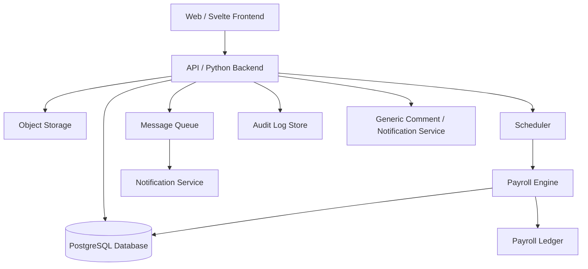

# System Architecture

## Overview

OC HQ is a project + HRIS platform. Project managers create projects and assign tasks; users complete tasks and provide an external deliverable link (e.g. Google Drive); project managers review submissions, and HR finalizes payroll. The system calculates payroll automatically twice per month.

The design borrows from project management tools (Jira, Monday.com, ClickUp, Trello) and payroll/HRIS platforms (BambooHR, Gusto).

## Core Modules

1. **Identity & HR** — users, roles, authentication, and departments.
2. **Project & Tasks** — projects, task types, tasks, assignments, submissions, and approvals.
3. **Payroll** — payroll periods, payroll entries, payroll line items, and disbursement.
4. **Collaboration & Audit** — generic comments, notifications, ledger, and audit logs.

## Actors

- **Admin** — platform management and user administration.
- **Project Manager** — creates projects, defines task types, assigns tasks, and approves submissions.
- **HR** — approves payroll entries and processes disbursements.
- **User / Worker** — completes assigned tasks and provides an external deliverable link.

## Architecture Diagram

## Data Integrity

- All state-changing operations write to `AuditLog`.
- Financial events (approved task submissions, payroll adjustments) write to `Ledger`.
- `Comment` and `Notification` are polymorphic and reference `Task`, `TaskSubmission`, `PayrollEntry`, etc.
- Approval and payroll generation are wrapped in database transactions.

## External References

- Project management: Jira, Monday.com, ClickUp, Trello.
- HRIS / payroll: BambooHR, Gusto.
