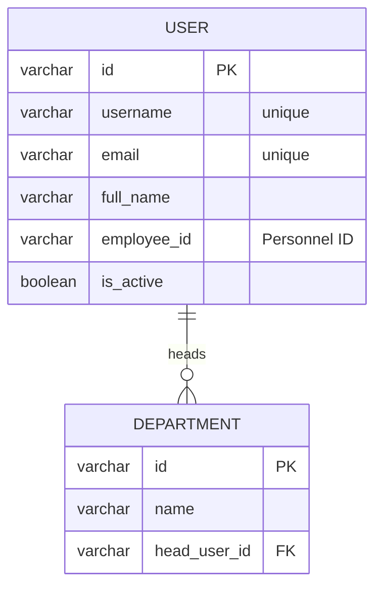
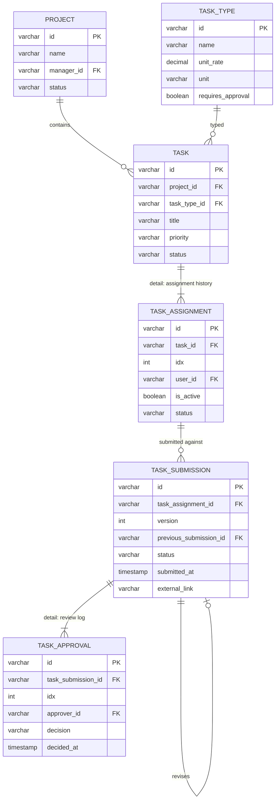
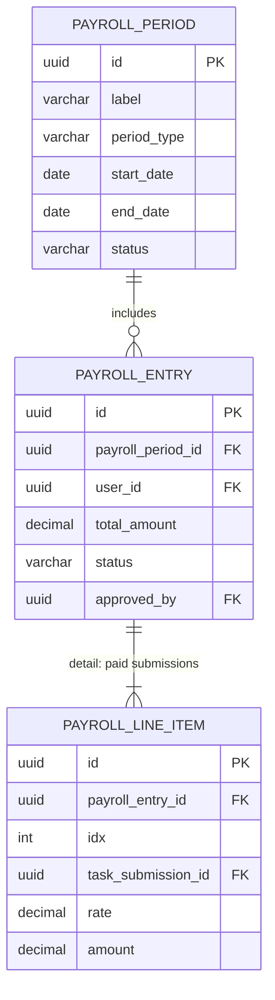
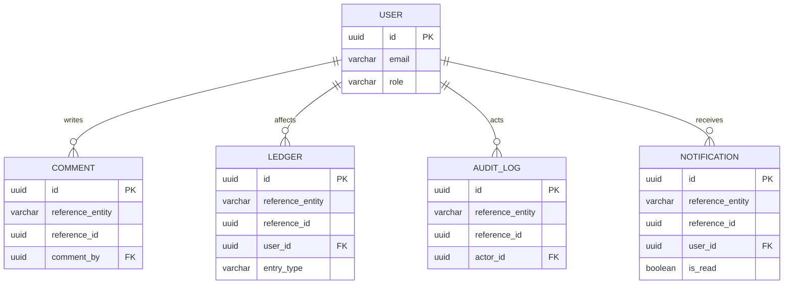
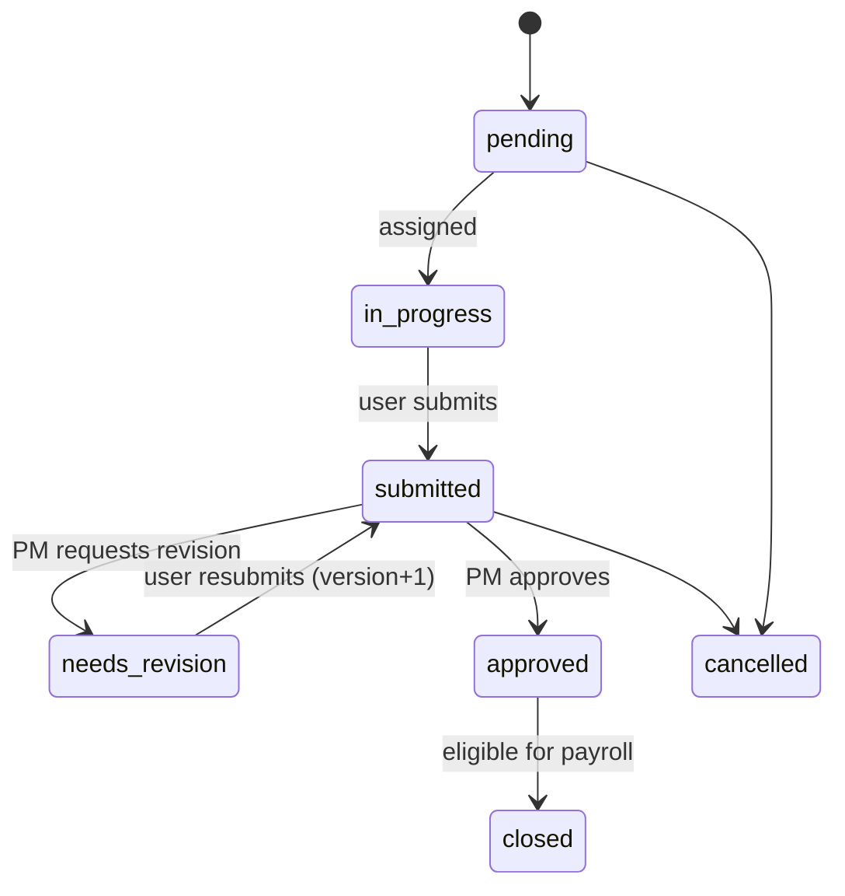
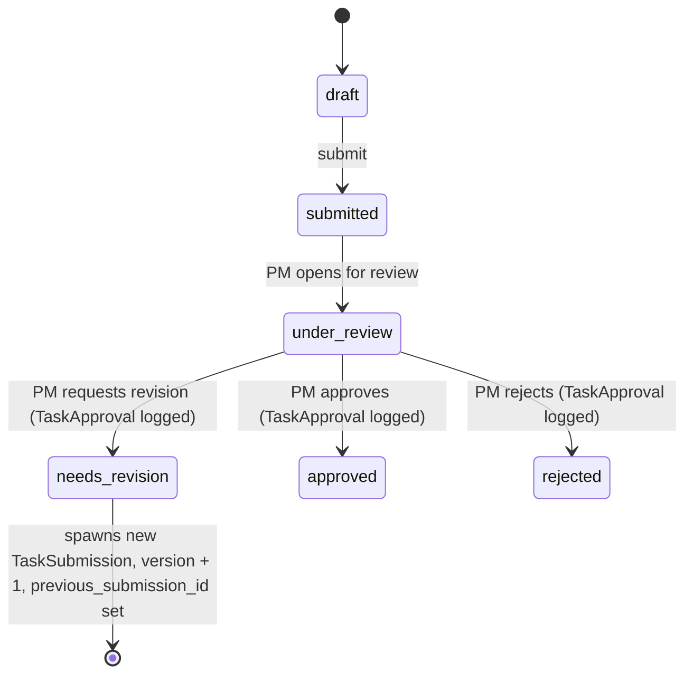
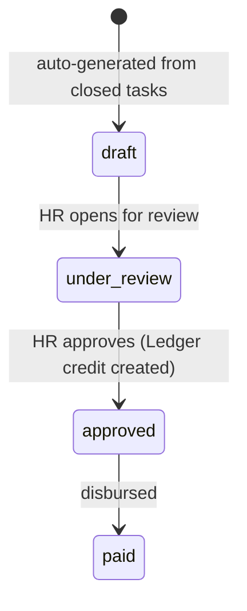

# Entity-Relationship Diagram — v3

## Changes from v2

| Change                    | Detail                                                                                                                                                                 |
| ------------------------- | ---------------------------------------------------------------------------------------------------------------------------------------------------------------------- |
| Metadata engine removed   | Your own metadata engine already covers this — dropped the entity/field/permission/workflow definition tables and their ERD entirely.                                  |
| Terminology               | "doctype" replaced with **entity** everywhere, including the generic link fields (`reference_doctype` → `reference_entity`).                                           |
| Header / detail structure | Introduced below — several entities are now explicit **detail (child) entities** of a **header entity**, which removes redundant relationship lines from the diagrams. |
| Diagrams split by module  | One ERD per module instead of one large diagram, plus the workflow (state) diagrams for the entities that actually move through a status lifecycle.                    |

---

## Header vs. Detail entities

Two kinds of entities show up below:

- **Header entity** — has its own identity, its own status/lifecycle, and is queried/listed on its own (e.g. `Task`, `TaskSubmission`, `PayrollEntry`).
- **Detail entity** — belongs to exactly one header, has no lifecycle of its own, is always created/edited/deleted alongside its parent, and is rendered as a nested grid on the parent's page rather than its own list. Detail entities carry an `idx` field for display order.

This is different from the **generic/polymorphic** entities (`Comment`, `Ledger`, `AuditLog`, `Notification`), which reference _many different kinds_ of headers via `reference_entity` + `reference_id`. They render nested in the UI too, but structurally they aren't owned by one fixed parent, so they aren't "detail entities" in the strict sense.

| Header           | Detail (child)    | Why it's a detail, not its own entity                                                                           |
| ---------------- | ----------------- | --------------------------------------------------------------------------------------------------------------- |
| `Task`           | `TaskAssignment`  | An assignment is just the history log of who a task was given to and when — no independent workflow.            |
| `TaskSubmission` | `TaskApproval`    | An approval is a single review decision on one submission — nothing references it from outside that submission. |
| `PayrollEntry`   | `PayrollLineItem` | A line item is just one paid submission's amount inside an entry — classic invoice/line pattern.                |

---

## Module: Identity & HR

### User (header)

| Field                   | Type      | Description        |
| ----------------------- | --------- | ------------------ |
| id                      | varchar   | PK (UUID)          |
| username                | varchar   | unique login       |
| email                   | varchar   | unique             |
| full_name               | varchar   |                    |
| hashed_password         | text      | hashed             |
| first_name / last_name  | varchar   |                    |
| contact_number          | varchar   |                    |
| department              | varchar   |                    |
| site                    | varchar   |                    |
| employee_id             | varchar   | Personnel ID label |
| is_active               | boolean   |                    |
| is_superuser            | boolean   |                    |
| created_at / updated_at | timestamp |                    |

### Department (header)

| Field                         | Type      | Description          |
| ----------------------------- | --------- | -------------------- |
| id                            | varchar   | PK                   |
| name                          | varchar   |                      |
| head_user_id                  | varchar   | FK to User, nullable |
| created_by / last_modified_by | varchar   | FK to User           |
| created_at / updated_at       | timestamp |                      |

---

## Module: Project & Tasks

### Project (header)

| Field                         | Type      | Description                       |
| ----------------------------- | --------- | --------------------------------- |
| id                            | varchar   | PK                                |
| name                          | varchar   |                                   |
| description                   | text      |                                   |
| manager_id                    | varchar   | FK to User (project_manager role) |
| status                        | enum      | active, archived                  |
| start_date / end_date         | date      |                                   |
| created_by / last_modified_by | varchar   | FK to User                        |
| created_at / updated_at       | timestamp |                                   |

### TaskType (header)

| Field                         | Type      | Description                                   |
| ----------------------------- | --------- | --------------------------------------------- |
| id                            | varchar   | PK                                            |
| name                          | varchar   | e.g. Data Entry, Verification                 |
| description                   | text      |                                               |
| unit_rate                     | decimal   | payment per unit                              |
| unit                          | enum      | per_task, per_hour, per_deliverable, per_unit |
| requires_approval             | boolean   |                                               |
| created_by / last_modified_by | varchar   | FK to User                                    |
| created_at / updated_at       | timestamp |                                               |

### Task (header)

| Field                         | Type      | Description                                                                  |
| ----------------------------- | --------- | ---------------------------------------------------------------------------- |
| id                            | varchar   | PK                                                                           |
| project_id                    | varchar   | FK to Project                                                                |
| task_type_id                  | varchar   | FK to TaskType                                                               |
| title                         | varchar   |                                                                              |
| description                   | text      |                                                                              |
| priority                      | enum      | low, medium, high, urgent                                                    |
| status                        | enum      | pending, in_progress, submitted, needs_revision, approved, closed, cancelled |
| due_date                      | timestamp |                                                                              |
| created_by / last_modified_by | varchar   | FK to User                                                                   |
| created_at / updated_at       | timestamp |                                                                              |

### TaskAssignment (detail of Task)

| Field                         | Type      | Description                                     |
| ----------------------------- | --------- | ----------------------------------------------- |
| id                            | varchar   | PK                                              |
| task_id                       | varchar   | FK to Task (parent)                             |
| idx                           | int       | display order in Task's assignment history grid |
| user_id                       | varchar   | FK to User                                      |
| assigned_by                   | varchar   | FK to User (project_manager)                    |
| assigned_at                   | timestamp |                                                 |
| unassigned_at                 | timestamp | nullable — set on reassignment                  |
| is_active                     | boolean   | only one active assignment per task             |
| status                        | enum      | active, completed, reassigned                   |
| created_by / last_modified_by | varchar   | FK to User                                      |
| created_at / updated_at       | timestamp |                                                 |

### TaskSubmission (header)

| Field                         | Type      | Description                                                        |
| ----------------------------- | --------- | ------------------------------------------------------------------ |
| id                            | varchar   | PK                                                                 |
| task_assignment_id            | varchar   | FK to TaskAssignment                                               |
| version                       | int       | increments each revision, starts at 1                              |
| previous_submission_id        | varchar   | FK to TaskSubmission (self), nullable — revision chain             |
| notes                         | text      | submitter's notes                                                  |
| status                        | enum      | draft, submitted, under_review, needs_revision, approved, rejected |
| submitted_by                  | varchar   | FK to User                                                         |
| submitted_at                  | timestamp |                                                                    |
| external_link                 | varchar   | URL to externally hosted deliverable (e.g. Google Drive)           |
| created_by / last_modified_by | varchar   | FK to User                                                         |
| created_at / updated_at       | timestamp |                                                                    |

### TaskApproval (detail of TaskSubmission)

| Field                         | Type      | Description                                         |
| ----------------------------- | --------- | --------------------------------------------------- |
| id                            | varchar   | PK                                                  |
| task_submission_id            | varchar   | FK to TaskSubmission (parent)                       |
| idx                           | int       | display order in the submission's review log        |
| approver_id                   | varchar   | FK to User (project_manager)                        |
| decision                      | enum      | approved, rejected, needs_revision                  |
| remarks                       | text      | required when decision = needs_revision or rejected |
| decided_at                    | timestamp |                                                     |
| created_by / last_modified_by | varchar   | FK to User                                          |
| created_at / updated_at       | timestamp |                                                     |

---

## Module: Payroll

### PayrollPeriod (header)

| Field                 | Type      | Description                 |
| --------------------- | --------- | --------------------------- |
| id                    | uuid      | PK                          |
| label                 | varchar   | e.g. "July 2026 — 1st Half" |
| period_type           | enum      | bi_monthly                  |
| start_date / end_date | date      |                             |
| cutoff                | date      |                             |
| status                | enum      | open, closed, paid          |
| is_auto_generated     | boolean   |                             |
| created_at            | timestamp |                             |

### PayrollEntry (header)

| Field             | Type      | Description                         |
| ----------------- | --------- | ----------------------------------- |
| id                | uuid      | PK                                  |
| payroll_period_id | uuid      | FK to PayrollPeriod                 |
| user_id           | uuid      | FK to User                          |
| total_tasks       | int       | count of closed tasks in the period |
| total_amount      | decimal   | computed sum of line items          |
| status            | enum      | draft, under_review, approved, paid |
| generated_at      | timestamp |                                     |
| approved_by       | uuid      | FK to User (hr role)                |
| approved_at       | timestamp |                                     |

### PayrollLineItem (detail of PayrollEntry)

| Field              | Type      | Description                                            |
| ------------------ | --------- | ------------------------------------------------------ |
| id                 | uuid      | PK                                                     |
| payroll_entry_id   | uuid      | FK to PayrollEntry (parent)                            |
| idx                | int       | display order                                          |
| task_submission_id | uuid      | FK to TaskSubmission (the approved version being paid) |
| rate               | decimal   | copied from TaskType.unit_rate at payout time          |
| quantity           | decimal   | usually 1                                              |
| amount             | decimal   | rate \* quantity                                       |
| created_at         | timestamp |                                                        |

`PayrollLineItem.task_submission_id` reaches across modules into `TaskSubmission` from the Project & Tasks module — that's the one link tying "work done" to "work paid."

---

## Module: Collaboration & Audit (generic/polymorphic)

These entities aren't owned by one fixed parent — any header entity above can be referenced via `reference_entity` (the entity name, e.g. `"Task"`) + `reference_id` (that record's id).

### Comment

| Field            | Type      | Description                                   |
| ---------------- | --------- | --------------------------------------------- |
| id               | uuid      | PK                                            |
| reference_entity | varchar   | e.g. "Task", "TaskSubmission", "PayrollEntry" |
| reference_id     | uuid      | id of the referenced record                   |
| comment_by       | uuid      | FK to User                                    |
| comment_text     | text      |                                               |
| created_at       | timestamp |                                               |

### Ledger

| Field            | Type      | Description         |
| ---------------- | --------- | ------------------- |
| id               | uuid      | PK                  |
| reference_entity | varchar   | e.g. "PayrollEntry" |
| reference_id     | uuid      | related record id   |
| user_id          | uuid      | FK to User (payee)  |
| amount           | decimal   |                     |
| entry_type       | enum      | credit, debit       |
| description      | text      |                     |
| period           | date      | payroll period      |
| created_by       | uuid      | FK to User          |
| created_at       | timestamp |                     |

### AuditLog

| Field            | Type      | Description                            |
| ---------------- | --------- | -------------------------------------- |
| id               | uuid      | PK                                     |
| reference_entity | varchar   | e.g. "Task", "PayrollEntry"            |
| reference_id     | uuid      | record id                              |
| action           | enum      | create, update, delete, submit, cancel |
| old_values       | jsonb     |                                        |
| new_values       | jsonb     |                                        |
| actor_id         | uuid      | FK to User                             |
| ip_address       | varchar   |                                        |
| timestamp        | timestamp |                                        |

### Notification

| Field            | Type      | Description                                                           |
| ---------------- | --------- | --------------------------------------------------------------------- |
| id               | uuid      | PK                                                                    |
| user_id          | uuid      | FK to User                                                            |
| reference_entity | varchar   | e.g. "Task", "PayrollEntry"                                           |
| reference_id     | uuid      | nullable                                                              |
| type             | enum      | task_assigned, submission_reviewed, revision_requested, payroll_ready |
| message          | text      |                                                                       |
| is_read          | boolean   |                                                                       |
| created_at       | timestamp |                                                                       |

---

## Workflow diagrams

### Task lifecycle

### TaskSubmission revision chain

### PayrollEntry lifecycle

Each transition above corresponds to a status change on the relevant header entity (`Task`, `TaskSubmission`, `PayrollEntry`), and every decision point that involves a person (PM approving/rejecting, HR approving) writes a row into that header's detail log (`TaskApproval`) or triggers a side-effect (`Ledger`, `Notification`) — so the workflow state is always reconstructable from the entities themselves, independent of your metadata engine.
