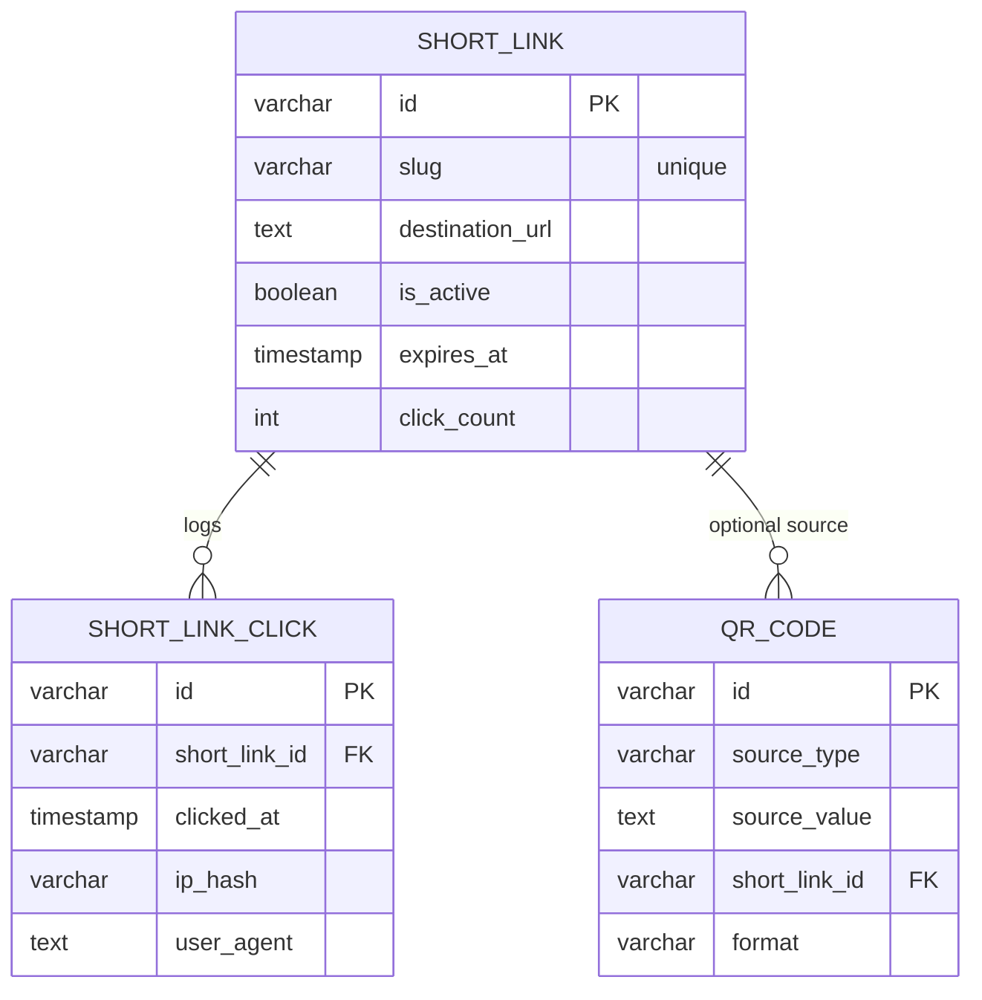
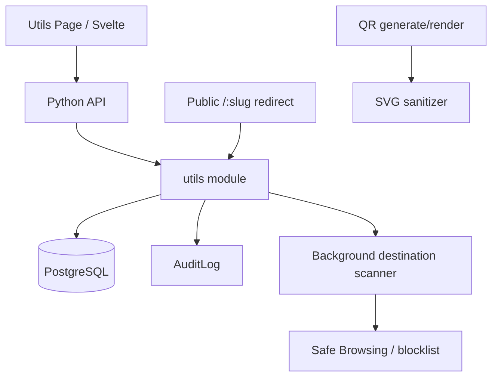

# Utils - Link Shortener and QR Generator

Design reference for the `07-23-26-utils-link-shortener-qr` epic. Covers the data model, architecture, and security model derived from published best practices for URL shorteners and QR generators.

## Overview

A Utils suite exposed under `/utils` in the sidebar, hosting two tools:

1. **Link Shortener** - Bitly-style short links with per-link click logs and aggregate analytics.
2. **QR Generator** - generate QR codes from URLs, text, or short links; download as SVG or PNG.

Both tools are authenticated-only for creation and share a common abuse-prevention and audit posture.

## Module

New backend module: `backend/app/modules/utils/` with `entities/` and `models/`, following the same layout as `collaboration_audit`. Business logic lives in `modules/utils/entities/<Entity>.py`. Use `forge.py` for scaffolding.

## Data Model

### ShortLink (header)

| Field                   | Type      | Description                                                          |
| ----------------------- | --------- | -------------------------------------------------------------------- |
| id                      | varchar   | PK (UUID)                                                            |
| slug                    | varchar   | unique short code (base62, allowlisted charset for custom slugs)     |
| destination_url         | text      | long URL; must be `http`/`https`                                     |
| title                   | varchar   | optional label                                                       |
| created_by              | varchar   | FK to User                                                           |
| is_active               | boolean   | soft deactivate; inactive links return 410                           |
| expires_at              | timestamp | nullable; past expiry returns 410                                    |
| password_hash           | text      | nullable; optional password protection (hashed, constant-time check) |
| click_count             | int       | denormalized counter, default 0                                      |
| created_at / updated_at | timestamp |                                                                      |

### ShortLinkClick (detail/log of ShortLink, immutable)

| Field          | Type      | Description                                            |
| -------------- | --------- | ------------------------------------------------------ |
| id             | varchar   | PK (UUID)                                              |
| short_link_id  | varchar   | FK to ShortLink                                        |
| clicked_at     | timestamp | event time                                             |
| ip_hash        | varchar   | hashed/truncated IP for privacy; never raw IP          |
| user_agent     | text      | redacted/truncated                                     |
| referer        | text      | nullable; redacted                                     |
| country        | varchar   | nullable; geo lookup                                   |
| created_at     | timestamp |                                                        |

### QrCode (header)

| Field                     | Type      | Description                                  |
| ------------------------- | --------- | -------------------------------------------- |
| id                        | varchar   | PK (UUID)                                    |
| source_type               | varchar   | `url` \| `text` \| `short_link`              |
| source_value              | text      | encoded content (validated)                  |
| short_link_id             | varchar   | FK to ShortLink, nullable                    |
| error_correction_level    | varchar   | `L` \| `M` \| `Q` \| `H`                     |
| size                      | int       | pixel size                                   |
| format                    | varchar   | `svg` \| `png`                               |
| fg_color                  | varchar   | hex color                                    |
| bg_color                  | varchar   | hex color                                    |
| created_by                | varchar   | FK to User                                   |
| created_at / updated_at   | timestamp |                                              |

## Architecture

- Creation/management endpoints are authenticated; the `/{slug}` redirect endpoint is public.
- The generic entity query service handles list/detail reads; dedicated endpoints handle create/redirect/QR-generate to keep validation and side effects explicit.
- A scheduled background job re-scans live destinations against blocklists and auto-deactivates newly malicious links.

## Security Model

Informed by published URL-shortener and QR security guidance (destination validation, blocklist scanning at creation and on a schedule, per-account rate limiting, signed/expiring tokens, SVG sanitization, click-time protection, audit trails).

### Link shortener

- **Access control** - authenticated creation only; per-user RBAC (owner vs admin scopes). No anonymous creation.
- **Input validation** - reject `javascript:`, `data:`, `vbscript:` URIs; require `http`/`https`; validate custom slug charset; cap destination length.
- **Destination scanning** - check against a malicious-domain blocklist and Google Safe Browsing v4 (where configured) at creation time and via a recurring background scan. Block above threshold; quarantine/score 40-79.
- **Rate limiting** - progressive per-user throttling on creation; per-IP limits on the public redirect endpoint.
- **Link lifecycle** - `expires_at`, `is_active`, and server-side revocation; auto-deactivate on malicious destination detection.
- **Password protection** - optional; store hash only, constant-time compare, never log.
- **Click-time protection** - optional preview/interstitial showing the destination with a click-through warning; `Referrer-Policy: no-referrer` and CSP on interstitials.
- **Privacy in logs** - hash/truncate IPs, redact sensitive query params, log only routing metadata.
- **Audit** - every create/update/delete and auto-deactivation writes `AuditLog`; notify owners on takedown.

### QR generator

- **Input validation** - reject disallowed URI schemes; constrain length/charset to library limits; validate server-side regardless of client checks.
- **SVG sanitization** - sanitize all SVG output (e.g. DOMPurify SVG profile) before DOM insertion; allowlist `svg`, `path`, `rect`, `g`, `polygon`, `line`; strip `<script>` and all `on*` handlers and external references.
- **Safe rendering** - prefer component/canvas rendering over raw HTML injection; re-sanitize on re-render from history.
- **Safe download** - correct `Content-Type`, `Content-Disposition: attachment`, and `Content-Security-Policy: default-src 'none'` for SVG downloads.
- **Rate limiting** - per-user generation throttle, reusing the link-side mechanism.
- **Audit** - every generation writes `AuditLog`.

## References

- `docs/erd/ERD.md` - header/detail and polymorphic patterns.
- `docs/architecture/ARCHITECTURE.md` - module and audit conventions.
- `epics/07-23-26-utils-link-shortener-qr/README.md` - epic and sprint plan.
- `epics/DEVIN.md` - epic and story format.
