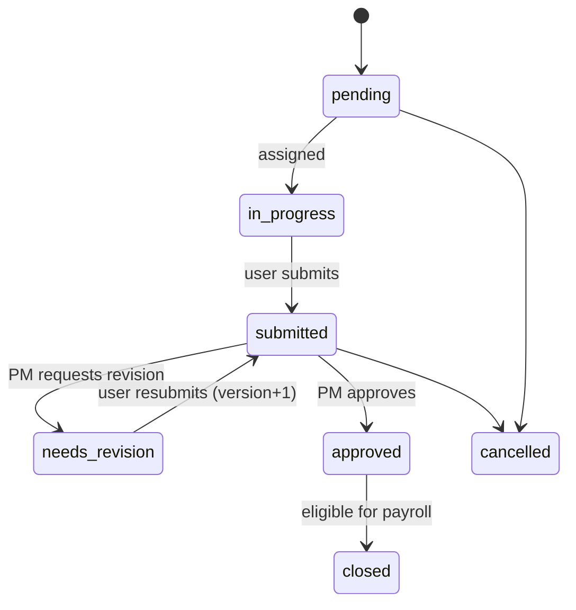
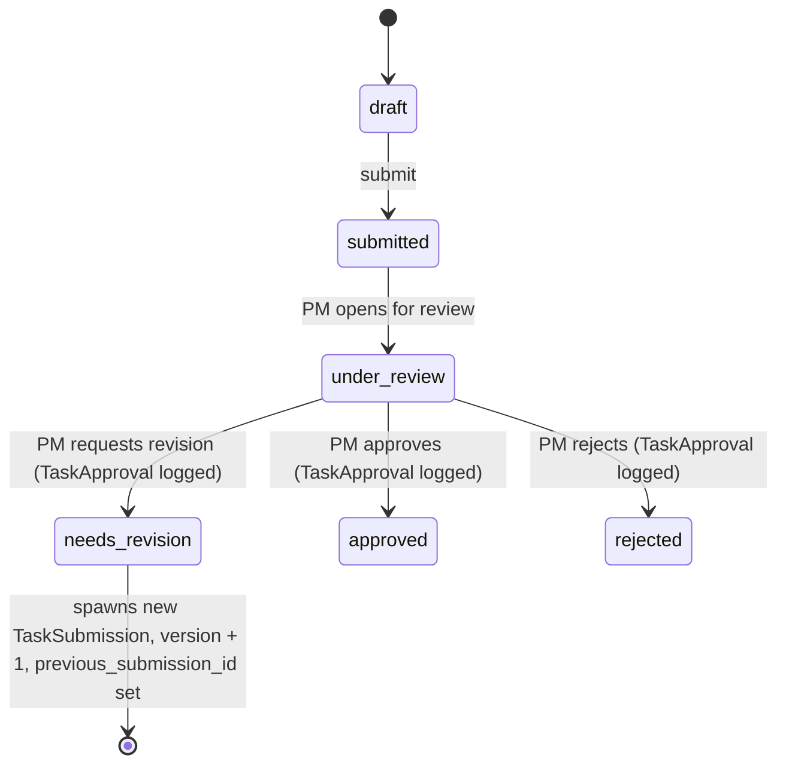

# HRIS and Payroll Design

## Overview

The HRIS module handles user data, task assignment, submission review, verification, and payroll. It is modeled after project management tools (Jira, Monday.com, ClickUp, Trello) and payroll/HRIS platforms (BambooHR, Gusto).

Workers are modeled directly in the `User` entity and linked to `Department`.

## Actors

- **Admin** - platform setup, user management, and escalation.
- **Project Manager** - creates projects, defines task types, assigns tasks, and verifies task submissions.
- **HR** - reviews payroll entries and processes disbursements.
- **User / Worker** - views assigned tasks, provides an external deliverable link, and submits/revises work.

## Task Lifecycle



## Task Submission Revision Chain



## Payroll Calculation

1. A `PayrollPeriod` covers half a month (1st-15th, 16th-end of month).
2. The payroll engine scans `TaskSubmission` records with `status = approved` and `decided_at` within the period.
3. For each approved submission, it creates a `PayrollLineItem` pointing to `TaskSubmission` and using `TaskType.unit_rate`.
4. `PayrollEntry.total_amount` is the sum of line items for the user.
5. `Ledger` records a credit entry for each approved submission and a debit entry for the final payout.

### Formula

```text
PayrollLineItem.amount = TaskType.unit_rate * PayrollLineItem.quantity
PayrollEntry.total_amount = SUM(PayrollLineItem.amount)
```

## Verification Workflow

1. User submits a `TaskSubmission` with an optional `external_link` to the externally stored deliverable.
2. The Project Manager reviews the submission and adds a `TaskApproval` decision.
3. If approved, `TaskSubmission` becomes `approved` and `Task` becomes `approved`.
4. On payroll generation, the `Task` moves to `closed` and `Ledger` records the credit.
5. If rejected or needs revision, the user is notified and can create a new revision.

## Data Integrity

- `AuditLog` captures every create/update/delete of user, project, task, submission, approval, and payroll data.
- `Ledger` captures every financial event (credit when approved, debit when paid).
- `Comment` and `Notification` are generic/polymorphic and reference `Task`, `TaskSubmission`, `PayrollEntry`, etc.
- Generated payroll entries are immutable once approved; adjustments create new `Ledger` entries.

## Bi-Monthly Schedule

- **Period 1:** 1st to 15th, generated on the 16th.
- **Period 2:** 16th to end of month, generated on the 1st of the next month.

## Key Interfaces

- Project board (Trello-like columns for task statuses).
- Task detail with external link, submission history, and approval log.
- Payroll dashboard for HR/PM.
- User task list.

## References

- Project management: Jira, Monday.com, ClickUp, Trello.
- Payroll/HRIS: BambooHR, Gusto.
